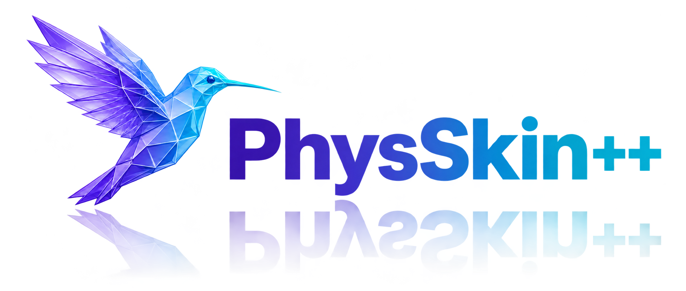
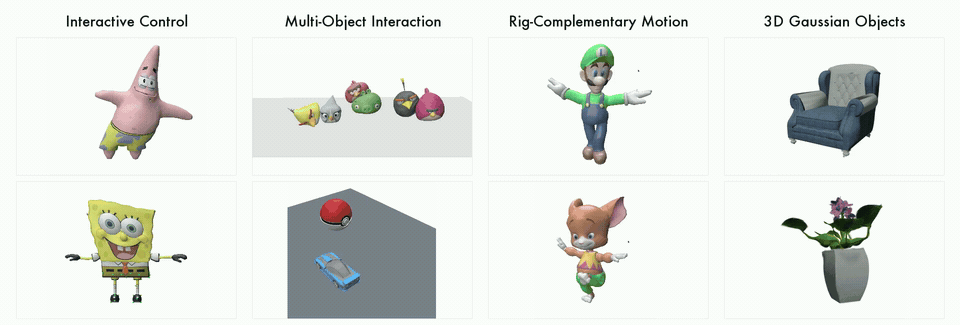
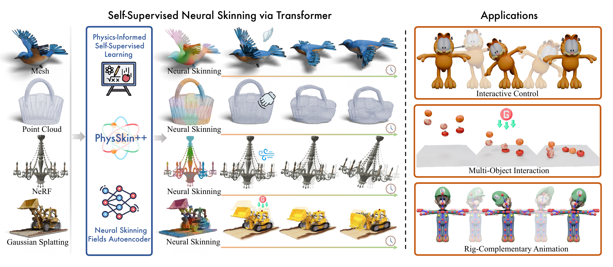

<p align="center">
  <a href="https://zju3dv.github.io/PhysSkin_plus/">
    
  </a>
</p>

<h3 align="center">
  Real-Time and Generalizable Physics-Based Animation<br>
  via Self-Supervised Neural Skinning
</h3>

<p align="center">
  <a href="https://arxiv.org/abs/2610.26067"></a>
  <a href="https://arxiv.org/abs/2603.23194"></a>
  <a href="https://zju3dv.github.io/PhysSkin_plus/"></a>
  <a href="https://huggingface.co/papers/2610.26067?image-viewer=B81F15613A4EABA144DFC55E0D95B4EA498EE910"></a>
  <a href="https://huggingface.co/papers/2610.26067"></a>
</p>

<p align="center"><b>From static 3D geometry to interactive, physics-based motion.</b></p>

<p align="center">
  <a href="https://huggingface.co/papers/2610.26067?image-viewer=B81F15613A4EABA144DFC55E0D95B4EA498EE910">
    
  </a>
  <br>
  <a href="https://huggingface.co/papers/2610.26067?image-viewer=B81F15613A4EABA144DFC55E0D95B4EA498EE910"><b>▶ Watch the 90-second preview</b></a>
  &nbsp; · &nbsp;
  <a href="https://zju3dv.github.io/PhysSkin_plus/">Explore all demos</a>
</p>

<p align="center">
  <a href="#papers">Papers</a> &nbsp; / &nbsp;
  <a href="#overview">Overview</a> &nbsp; / &nbsp;
  <a href="#method">Method</a> &nbsp; / &nbsp;
  <a href="#installation">Installation</a> &nbsp; / &nbsp;
  <a href="#visualization">Visualization</a> &nbsp; / &nbsp;
  <a href="#citation">Citation</a>
</p>

## Papers

**October 2026 — PhysSkin++ is now on arXiv.** Explore the [paper](https://arxiv.org/abs/2610.26067), [preview video](https://huggingface.co/papers/2610.26067?image-viewer=B81F15613A4EABA144DFC55E0D95B4EA498EE910), and [demo gallery](https://zju3dv.github.io/PhysSkin_plus/).

| Work | Publication | Links |
| :--- | :--- | :--- |
| **PhysSkin++** | arXiv 2026 | [arXiv](https://arxiv.org/abs/2610.26067) · [Project](https://zju3dv.github.io/PhysSkin_plus/) · [Hugging Face](https://huggingface.co/papers/2610.26067) |
| **PhysSkin** | **CVPR 2026 · Highlight** | [arXiv](https://arxiv.org/abs/2603.23194) · [Project](https://zju3dv.github.io/PhysSkin/) |

**PhysSkin++ authors:** Yuanhang Lei, Baofei Liu, Xingxuan Li, Tao Cheng, Zixuan Wang, Boming Zhao, Yujun Shen, Siyuan Huang, Ruizhen Hu, Peter Yichen Chen, Hujun Bao, and Zhaopeng Cui.

<details>
<summary>PhysSkin (CVPR 2026) authors</summary>

Yuanhang Lei, Tao Cheng, Xingxuan Li, Boming Zhao, Siyuan Huang, Ruizhen Hu, Peter Yichen Chen, Hujun Bao, and Zhaopeng Cui.

</details>

## Overview

PhysSkin++ learns continuous neural skinning fields from static geometry to build compact deformation subspaces. Physics-informed self-supervision enables real-time reduced simulation across diverse shapes without per-object network training or simulation trajectories for supervision.

| Interactive control | Multi-object interaction | Rig-complementary animation |
| :--- | :--- | :--- |
| Drive elastic motion with user input and boundary constraints. | Simulate contact between deformable objects and their surroundings. | Add complementary elastic responses to prescribed rig motion. |

The framework supports animation across **meshes, point clouds, NeRFs, and 3D Gaussians**.



## Method

The framework combines a transformer-based shape encoder, a cross-attention field decoder, and physics-informed self-supervised objectives.


## Installation

The code was tested with Python 3.11, PyTorch 2.7.1, NumPy 1.26.4, PyTorch Lightning 1.6.4, and `conflictfree` 0.1.8.

```bash
python -m pip install "pip<24.1"
pip install torch==2.7.1 --index-url https://download.pytorch.org/whl/cu118
pip install -r requirements.txt
```

## Data

```text
<dataset_root>/
└── 00000001/
    └── <model_id>/
        └── models/
            └── samples/
                ├── latents.npz
                └── internal_filled.npz
```

- `latents.npz` contains `latents`, a `float32` array of shape `(1, 256, 768)`.
- `internal_filled.npz` contains `points`, a `float32` array of shape `(N, 3)` in approximately `[-0.5, 0.5]`.

The loader rescales the points to approximately `[-1, 1]`. Data splits are provided in `data/splits`, and processed examples for visualization are included in `data/examples`.

## Visualization

```
physskin_vis.ipynb
```

The notebook uses `data/examples` by default. A different sample or dataset can be selected with `MODEL_ID` and `DATASET_ROOT`.

## Training

```bash
DATASET_ROOT=/path/to/dataset \
GPU_IDS="0 1" \
bash scripts/train_physskin.sh
```

## Data preprocessing

```bash
pip install -r data_process/requirements.txt

DATASET_ROOT=/path/to/dataset \
SAMPLING_PYTHON=/path/to/python \
RAYTRACING_PYTHON=/path/to/python \
MICHELANGELO_ROOT=/path/containing/Michelangelo \
ENCODER_CHECKPOINT=/path/to/shape_encoder.pth \
bash data_process/process_data.sh 00000001 0
```

## Checkpoint

The pretrained checkpoint is stored at `checkpoints/physskin_rignet_epoch150.pt`.


## Acknowledgements

This project builds upon [Simplicits](https://github.com/NVIDIAGameWorks/kaolin/tree/master/kaolin/physics/simplicits), [Michelangelo](https://github.com/NeuralCarver/Michelangelo), and [ConFIG](https://github.com/tum-pbs/ConFIG). See [THIRD_PARTY_NOTICES.md](THIRD_PARTY_NOTICES.md) for details.

## Citation

### PhysSkin++

```bibtex
@misc{lei2026physskinplus,
    title         = {PhysSkin++: Real-Time and Generalizable Physics-Based Animation via Self-Supervised Neural Skinning},
    author        = {Yuanhang Lei and Baofei Liu and Xingxuan Li and Tao Cheng and Zixuan Wang and Boming Zhao and Yujun Shen and Siyuan Huang and Ruizhen Hu and Peter Yichen Chen and Hujun Bao and Zhaopeng Cui},
    year          = {2026},
    eprint        = {2610.26067},
    archivePrefix = {arXiv},
    primaryClass  = {cs.CV},
    url           = {https://arxiv.org/abs/2610.26067}
}
```

### PhysSkin (CVPR 2026)

```bibtex
@InProceedings{Lei_2026_CVPR,
    author    = {Lei, Yuanhang and Cheng, Tao and Li, Xingxuan and Zhao, Boming and Huang, Siyuan and Hu, Ruizhen and Chen, Peter Yichen and Bao, Hujun and Cui, Zhaopeng},
    title     = {PhysSkin: Real-Time and Generalizable Physics-Based Animation via Self-Supervised Neural Skinning},
    booktitle = {Proceedings of the IEEE/CVF Conference on Computer Vision and Pattern Recognition (CVPR)},
    month     = {June},
    year      = {2026},
    pages     = {32357-32366}
}
```
